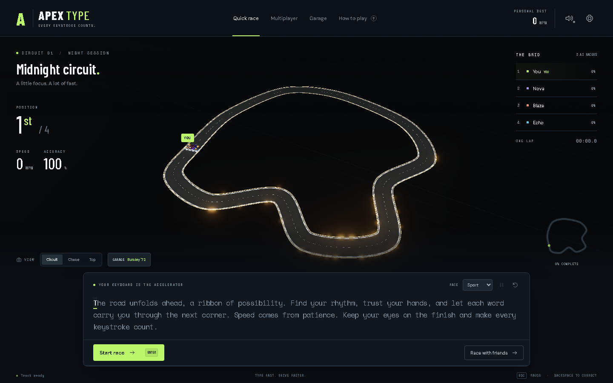
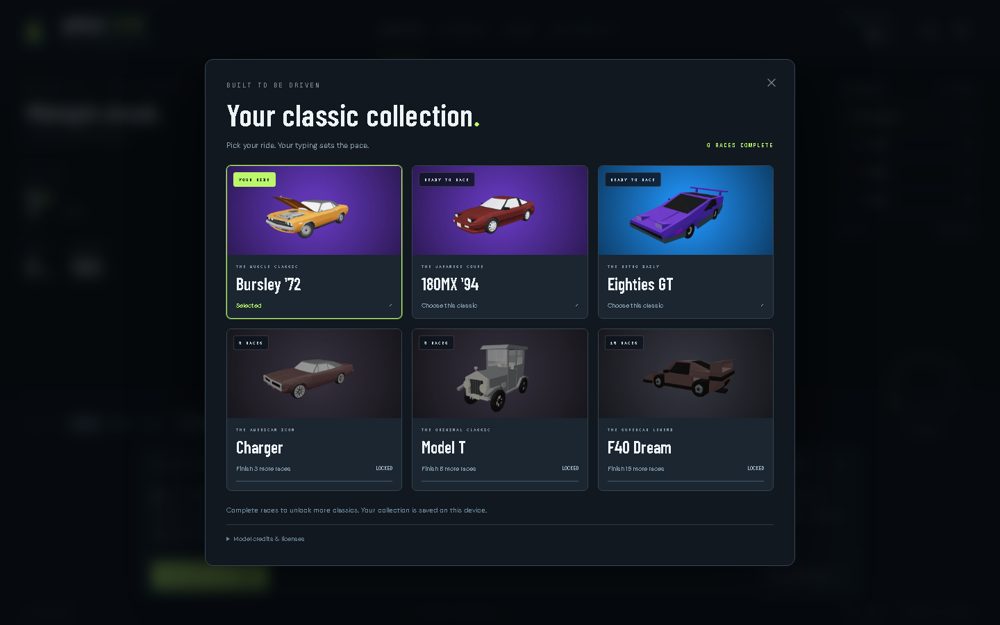
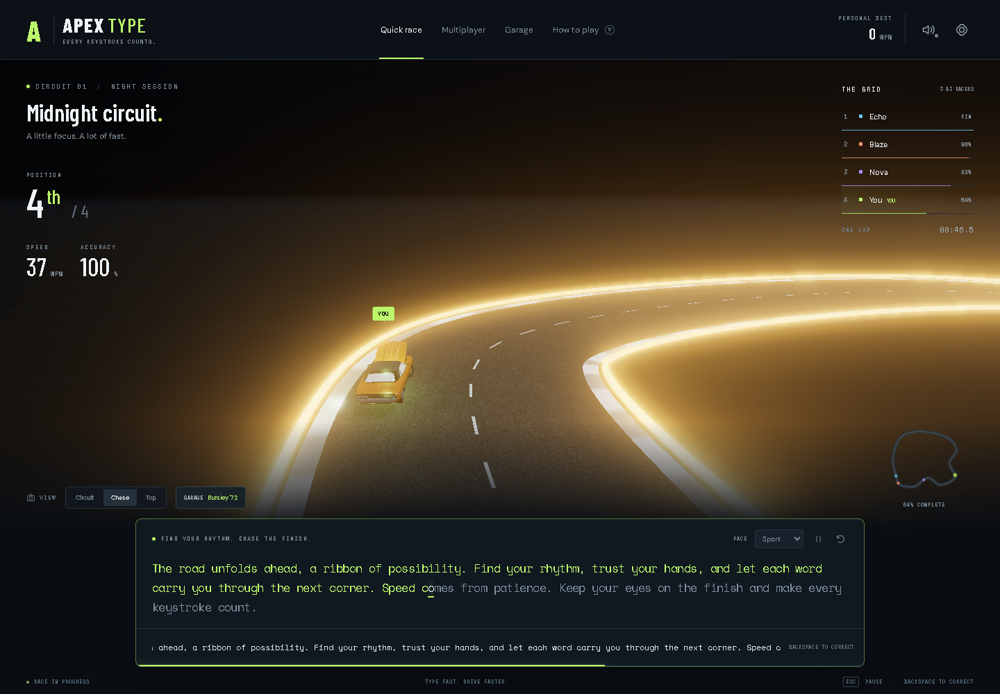
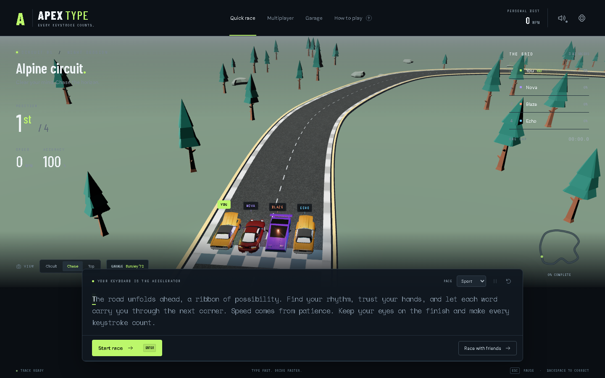
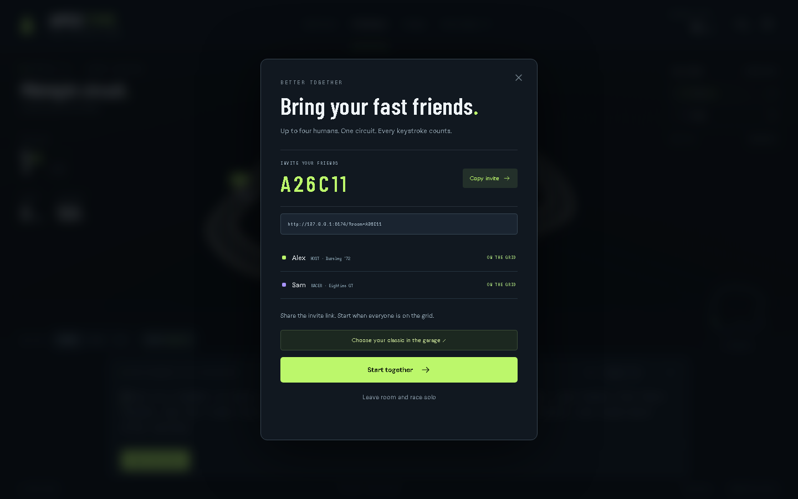
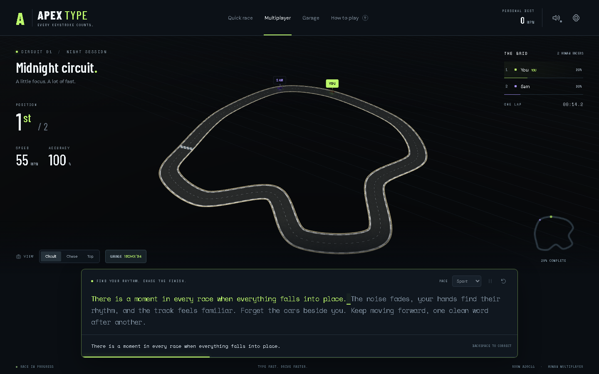
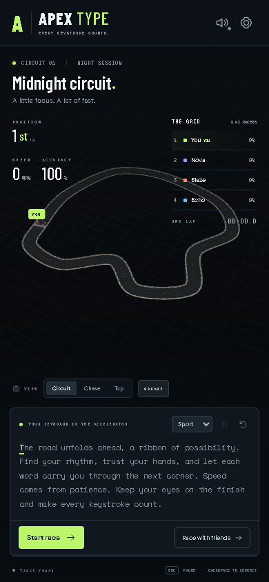
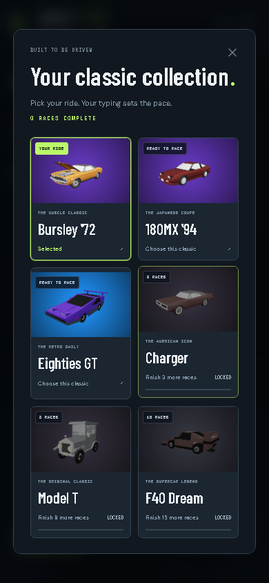

# APEX TYPE

**Your keyboard is the accelerator.** A typing racer on an actual 3D circuit, with classic cars, a collectible garage, and multiplayer rooms for up to four people.



**[Vercel deployment](https://apex-type-five.vercel.app/)** · [Gameplay](#play) · [Run locally](#run-locally) · [Screenshots](#screenshots)

## Play

Choose a classic in **Garage**, then start a quick race or create a multiplayer room. Type the passage exactly as shown. Correct characters move your car around the course; mistakes block progress until corrected with Backspace. Finish the passage to complete a lap.

- **Quick race:** three AI opponents, Rookie/Sport/Pro difficulty, Esc to pause, and personal-best tracking.
- **Multiplayer:** share a room link/code; the host starts a shared countdown. Everyone gets the same passage. Selected cars, progress, finish times, and rankings are shared through the server. Rematches open when the race ends.
- **Cameras:** Auto is the default: the view smoothly weaves from Chase to a wide Circuit view, returns to Chase, tracks from ahead looking back, and settles behind you for the final stretch. Shot changes follow lap progress. Manual Chase, Circuit, and Top remain selectable; reduced motion keeps a steady Chase.
- **Passages:** 32 original paragraphs. A random one is selected on page load, and each new solo race randomly picks a different one. Multiplayer rooms share their server-selected passage.
- **Atmospheres:** Midnight and Alpine sunrise.
- **Garage:** three starter classics, with more unlocked from completed laps. Progress and preferences are saved on the current device.
- **Settings:** optional engine/keystroke audio and performance graphics mode.

Multiplayer needs a shared backend. Publishing only the static frontend on GitHub Pages will not provide multiplayer. The local server serves independent browser sessions; the Sites Worker provides the hosted backend when deployed.

## Classic collection

| Car | Unlock |
| --- | --- |
| Bursley '72 | Available immediately |
| 180MX '94 | Available immediately |
| Eighties GT | Available immediately |
| Charger | Complete 3 races |
| Model T | Complete 8 races |
| F40 Dream | Complete 15 races |

All cars move at your typing speed. See [Adding cars](docs/ADDING_CARS.md) to extend the roster using `public/cars.json`.



## Run locally

Requires **Node.js 24+**. The multiplayer preview uses Node's built-in SQLite.

```sh
git clone https://github.com/remriel/apex-type.git
cd apex-type
npm ci
npm run dev
```

Open the printed local URL. To test two players, use separate browser profiles or an incognito window, create a room in one, and join from the other.

```sh
npm test
npm run build
npm start
```

`npm start` serves the exact production Worker at `http://127.0.0.1:5174/`. Set `PORT` to change the port. Development/production previews use separate in-memory databases; restarting removes local rooms. Hosted Sites uses persistent D1.

## Screenshots









 

## Architecture

- `src/simulation/race.ts`: pure typing, timing, AI, and ranking.
- `src/render/world.ts`: Three.js scene, spline circuit, GLB models, cameras, and minimap.
- `src/main.ts`: DOM HUD, dialogs, input, garage, and multiplayer orchestration.
- `src/network.ts`: room API, polling, clock synchronization, and refresh recovery.
- `src/garage.ts` + `public/cars.json`: collection, selection, and unlocks.
- `server/api.mjs`: room service, player/host authorization, validation, and shared starts.
- `server/local-db.mjs`: local SQLite adapter for the same D1 queries.
- `drizzle/`: append-only schema migrations.
- `scripts/build-worker.mjs`: standalone Sites Worker with embedded frontend assets.

The renderer follows simulation state. Arc-length progress drives the actual 3D cars and minimap on a closed spline. Collision physics are unnecessary for typing-controlled lanes.

## Sites deployment

The project includes `.openai/hosting.json` with a `DB` D1 binding, Worker output at `dist/server/index.js`, and migrations in `dist/.openai/drizzle/`. Register the Site, persist its actual project ID, use the Sites source workflow to push/package the exact source commit, and deploy the saved version.

**Hosting status:** new-site creation returned `site_hosting_usage_limit_reached`, including after a slot was freed. No live Sites URL is confirmed. This public repository contains the complete game and verified multiplayer backend. Continue hosting from this source when account availability changes.

## Verification

18 automated tests cover correction, countdowns, pause, AI, ranking, unlocks, room capacity, host-only starts, prefix/sequence validation, recovery, rematches, and shared car choice. TypeScript and the production build pass. Browser playtests cover full laps, two independent human clients, shared progress/results/rematch, classic selection/unlocks, cameras, and responsive layouts. See [QA](docs/QA.md), [Project state](docs/PROJECT_STATE.md), and [Progress](docs/PROGRESS.md).

## License and credits

Game source: [MIT](LICENSE). Third-party models and preview artwork retain their original licenses. Full creators, sources, license links, and modifications are in [Asset credits](docs/ASSETS.md) and the garage. Asphalt and the alpine environment were generated for this game.

## More browser games

- [Riftborne](https://github.com/remriel/riftborne): elemental magic and boss battles in a playable 3D browser alpha.
- [Katamari Neighborhood](https://github.com/remriel/katamari-neighborhood): a mobile-first 3D rolling and object-collecting game.
